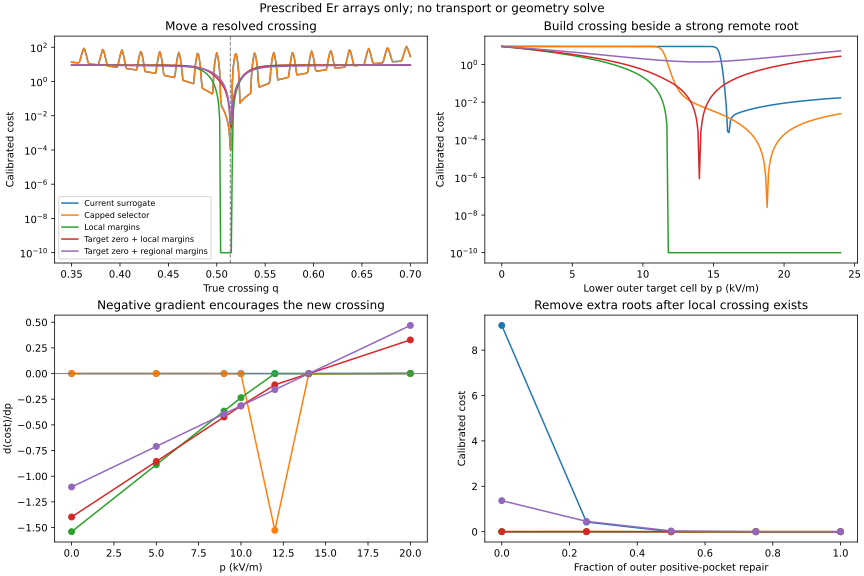

# Candidate electron-root loss comparison

**Updated scope:** these are prescribed-array results, not evidence of useful
physical profile/geometry gradients. The [physical DoF audit](../physical_dof_audit.md)
adds that comparison to the existing AD benchmark. The same follow-up
restricts sign penalties to a chosen annulus, allowing weak/negative core
Er and interpolated off-grid crossings, with a single overall root weight.

The strongest candidate in these controlled tests is **a zero condition at
the requested radius plus regional sign-margin penalties**. It gives useful
directions before the target crossing exists, follows the requested location,
and detects an unwanted positive pocket outside it. This is a comparison of
terminal loss formulas on prescribed Er arrays, not a transport optimization
or a measurement of actual profile-DoF sensitivities. Production objectives
have not been replaced.

The follow-up [fixed Er-left/right and softmax comparison](../left_right_softmax/README.md)
adds the original weighted objectives and checks their gradient support and
control requirements against these candidates.



## What was compared

The [comparison script](../../../../examples/benchmarks/compare_er_transition_loss_candidates.py)
evaluates 38 prescribed profiles/directions. Most use the production-style
51-cell centre grid and the current target rho=0.514, search window 0.05–0.9,
Er scale 2 kV/m, and strength threshold 0.9. Additional small cases isolate
averaging of distinct roots and a target located exactly on a grid node.

Each candidate receives one frozen multiplier making its cost equal to the
current cost, 9.087165056996739, on the same displaced-root reference profile:

```
Er(rho) = 10 * tanh((0.65 - rho) / 0.01)
```

This removes one arbitrary overall scale from the comparison. It does not
equalize curvature, make all losses impose identical requirements, or specify
production weights against net power/bootstrap. The internal zero/margin
terms have unit relative weights before this calibration.

| Candidate | Definition | Frozen multiplier |
| --- | --- | ---: |
| Current | Existing weighted selected-position and global strength-deficit loss | 1 |
| Capped selector | Same loss, but cap the strength entering the selection logits | 1 |
| Local margins | Require positive Er just inside the target and negative Er just outside it | 1.044201673 |
| Target zero + local | Local margins plus squared linearly interpolated Er at the target | 0.428589320 |
| Target zero + regional | Target zero plus sign-margin penalties across the search window | 0.613444886 |

These candidates seek crossing behavior rather than the former +26/-10 kV/m
amplitude targets. Margin penalties become inactive above sufficient amplitude
on the correct side.

## Explicit candidate formulas

Let `e_i = Er_i / 2`, `m = 0.9`, and
`phi(x) = (x + sqrt(x*x + 1e-12))/2`. Let L and R be the closest grid nodes
strictly inside/outside rho_target. If the target coincides with a node,
that node supplies the zero condition and its neighbors supply the margins.

```
C_local = 0.5 * mean([phi(m - e_L)^2, phi(m + e_R)^2])
C_zero = 0.5 * (interp(rho_target, rho, Er) / 2)^2
```

For the regional candidate, define h as the mean grid spacing and

```
a_i = (rho_target - rho_i) / sqrt((rho_target - rho_i)^2 + (h/2)^2)
C_regional = 0.5 * mean_window(phi(m*a_i^2 - a_i*e_i)^2)
C_target_zero_regional = C_zero + C_regional
```

Away from the target, this asks for roughly Er>=1.8 kV/m inside and
Er<=-1.8 kV/m outside. The margin and its influence taper to zero near the
target. At a node exactly on the target, `a_i=0`, so the regional condition
does not contradict `Er(rho_target)=0`. The zero residual supplies placement
there. This avoids demanding a nonzero margin at the requested zero itself.

The capped-selector variant replaces the score in the position-selection
logits by

```
capped_score = m - 0.25 * softplus((m - score) / 0.25)
```

The original global strength penalty is retained in that variant, isolating
whether changing the selector alone solves the problem.

## 1. Building the target crossing while another root is stronger

Starting from the reference, p lowers only cell 26, next to the target.
At p=0 there is no target bracket. Negative dC/dp encourages creating one.
All costs in this table are equal at p=0 by the frozen calibration.

| Candidate | dC/dp at p=0 | Cost at p=14 |
| --- | ---: | ---: |
| Current | +4.33e-29 | 9.08705471 |
| Capped selector | +4.33e-29 | 0.00661232 |
| Local margins | -1.54019747 | 1.44e-26 |
| Target zero + local | -1.39720118 | 8.57e-7 |
| Target zero + regional | -1.10457733 | 1.36693402 |

At p=14 the new bracket has a real interpolated root at 0.51400560 and
already exceeds the local strength threshold. The current selector continues
to favor the distant root. Capping improves selection after the target
candidate exists, but it supplies essentially no initial guidance to create
it. Its lowest sampled cost in this sweep is near p=18.8, even though the
actual local crossing is already almost exactly on target at p=14: the
selected average remains distinct from a particular physical crossing.

The regional candidate's remaining cost at p=14 is appropriate for its
stronger requirement: most of the positive pocket between the desired root
and the old outer root is still present. Changing one target cell cannot
repair that entire pocket.

## 2. Removing the extra roots after the local crossing exists

At p=14, a second direction changes only the positive pocket farther outside
the target. The target cells and interpolated target zero are unchanged.
Increasing the repair parameter turns that pocket negative.

| Candidate | dC/d(repair) at the starting point |
| --- | ---: |
| Current | -1.27934148 |
| Capped selector | +0.00564590 |
| Local margins | 0 |
| Target zero + local | 0 |
| Target zero + regional | -4.63056954 |

Local conditions cannot detect an error outside their support. The capped
selector even slightly disfavors the initial repair in this example.
The regional loss falls from 1.36693402 to 1.22689e-6 as the pocket is repaired;
the number of downcrossings goes from two to one and the sampled wrong-sign
fraction goes from 6/43 to zero. The remaining tiny cost is the unchanged
target-zero interpolation mismatch.

This does not mean the current loss never has useful gradients. Here it also
favors repair of the remote pocket; its earlier failure is its near-zero
response to building the target candidate in a different direction.

## 3. A mean root radius can report a false success

A four-node profile has Er=(10,-10,10,-10) at radii
(target-0.13,target-0.11,target+0.11,target+0.13). There are two downcrossings,
each 0.12 away from the target. At the target the interpolated crossing is
upward, which is the wrong orientation.

Both the current and capped selectors return a weighted mean at the target,
with sufficient global strength: their costs are about 1.99e-25. No actual
downcrossing is near the requested radius. The local, zero+local and
zero+regional candidates give costs 18.1743, 7.45960 and 4.52373 respectively.
They reject this false success by testing the sign pattern itself.

## 4. The existing strength definition creates radial grid barriers

The translation scan uses `Er=10*tanh((q-rho)/0.02)`, whose continuous
downcrossing is q. The current loss exhibits repeated spikes as q passes
near successive grid nodes. The score is based on the weaker of two endpoint
margins; one endpoint approaching zero lowers that score even when the
continuous transition remains steep and well resolved.

At q=0.58, already outside the target, the current derivative is
`dC/dq=-16674.2871`. Descent would initially move q farther outward. The
regional candidate instead gives a positive derivative toward the target.
Capping the selection score retains the original global strength penalty
and does not remove these barriers.

A separate node-aligned linear profile is
`Er=1000*(rho_target-rho)`, with a grid node exactly at the requested zero.
It has the correct orientation, one downcrossing exactly at the target, and
strong neighboring values. The current cost is **47.5572209** because its
face-based strength is negative; scaling the amplitude does not fix a zero
endpoint. The three sign-based candidate costs are effectively zero. This
is a structural limitation of the current strength definition, distinct from
incorrect automatic differentiation.

## 5. Important tradeoffs that remain

- Local margins alone accept an interval of root positions within a grid
  bracket; they do not pin the requested radius. The target-zero residual
  removes this plateau.
- Zero+local can still have tiny derivatives for a translating front far from
  the target, because the target samples lie on a flat tanh plateau. At
  q=0.35, dC/dq is about -6.4e-4 for zero+local, versus an order-ten gradient
  toward the target for the regional candidate. The latter acts on the front where
  it currently is, as well as at the target.
- The regional candidate asks for the correct sign throughout 0.05–0.9. This
  is stronger than requiring one local crossing. It is appropriate if the
  intended state is positive inside and negative outside that transition;
  it would need a different window if additional sign changes are allowed.
- The zero residual is not amplitude-invariant away from its solution. Its
  sensitivity to a translated root depends on the local Er slope. Correctly
  placed sufficiently strong linear crossings have essentially no pressure
  to increase amplitude further, but incorrectly placed profiles can lower
  their cost by weakening the field.
- The wrong-root amplitude sweep demonstrates that last tradeoff. For a
  fixed root near 0.65, regional costs at amplitude factors 0, 0.05 and 0.1
  are 0.2350, 0.1786 and 0.1966. Thus an amplitude-only search can prefer a
  weak, still misplaced crossing. That state retains nonzero deficit cost;
  this candidate does not guarantee relocation when the available directions
  cannot move the root or competing objectives outweigh the sign penalties.
- No terminal loss can recover root motion that leaves the sampled Er values
  locally unchanged. Underresolved tanh transitions still have small
  dEr/dq. The new losses change the local Er cotangents, not the transport
  sensitivity itself.

## Recommendation and limits

For an intended positive-inside/negative-outside pattern, the regional
candidate is the best next formulation to integrate: it removes selection
competition, rejects phantom mean roots, and provides pressure on both a
missing target bracket and misplaced sign regions. Use the target-zero term
for position and separate deficit terms for the desired sign/strength.

If only the immediate target bracket matters and extra roots elsewhere are
allowed, zero+local is the smaller change. Capping the selector alone and
local margins alone each leave demonstrated gaps.

The archived AD benchmark does not include the complete spatial
`dEr_i/d(profile parameter)` needed to contract these new cotangents at the
same physical state. Therefore none of the reported artificial-coordinate
gradients is being presented as a new n0/T0/profile-shape derivative or a
proven fix for the remote optimization. Production weights and behavior
against net power/bootstrap remain to be established after choosing the
desired sign-pattern scope.

## Evidence and reproduction

- [Costs, gradients and physical crossing diagnostics](candidates.csv):
  38 prescribed cases × 5 losses, including zero, all-positive/all-negative,
  reversed orientation, amplitude changes and resolution checks.
- [Two one-dimensional landscapes](landscapes.csv): translating a resolved
  root and creating a target bracket beside a remote root.
- [Frozen calibration factors](calibration.csv).
- [Plot](candidate_comparison.svg).

```bash
cd ~/NEOPAX
JAX_PLATFORMS=cpu PYTHONPATH="$HOME/VMEX:$HOME/NTX/src" \
python examples/benchmarks/compare_er_transition_loss_candidates.py \
  --out-dir outputs/er_transition_loss_candidates
```

The script explicitly disables persistent compilation caching after NEOPAX
imports. Its prescribed-direction AD/FD comparison has maximum scaled error
`1.3873e-6`, using `abs(AD-FD)/max(1,abs(AD),abs(FD))`; the maximum absolute
error is `1.9664e-5`. Zero-profile finite differences use a smaller step to
resolve the existing 2e-6 kV/m smoothing scale.

Nine new lightweight tests passed, including independent NumPy value and
directional-FD formulas, target-creation starvation, false mean roots,
extra-root repair, the local-margin plateau, sufficient-amplitude neutrality,
and the grid-node case. The earlier combined run also passed all 12 existing
objective tests (20 tests plus 25 subtests before adding the ninth candidate
test). No VMEC, NTX, ambipolar root, transport or production optimizer was run.
