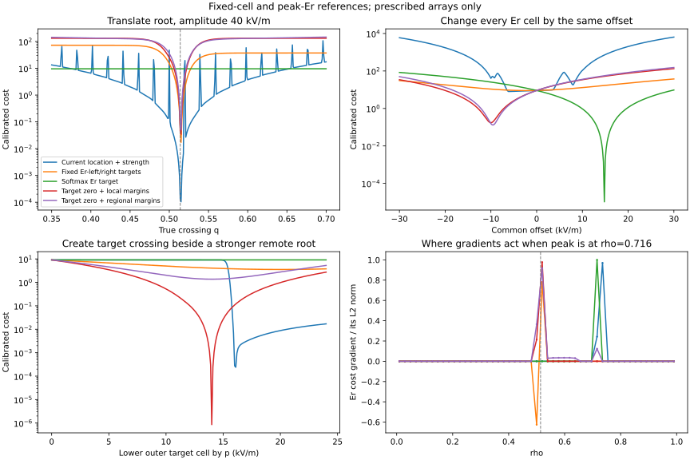

# Er-left/right and softmax Er versus root-loss candidates

**Softmax Er controls a peak anywhere; Er-left/right impose two prescribed
values at fixed cells.** The latter have useful local derivatives, but require
independent control of the two cells. Their failure is not the same mechanism
as the current selected-root loss ignoring a new target crossing.

This follow-up compares the exact production observables and weighted costs
with all five losses from the [candidate audit](../candidates/README.md).
It uses 45 prescribed 51-cell cases and the already archived full-time AD
table. No plasma, root, geometry, transport, or production optimization was
run. Production objectives have not changed.



## Definitions and settings

The optimization example uses indices 25 and 26, located at rho=0.5 and
rho=0.519607843 on this grid. The costs evaluated here are

```
C_left  = 0.5 * 0.09 * (Er[25] - 26)^2
C_right = 0.5 * 0.09 * (Er[26] + 10)^2
C_pair  = C_left + C_right
F_peak  = logsumexp(16 * Er) / 16
C_peak  = 0.5 * 0.5 * (F_peak - 25)^2
```

F_peak is a signed smooth maximum over the whole Er array. It is neither an
absolute-value maximum nor a root-position objective. Its target is an
equality: values below 25 are encouraged upward, and values above 25 downward.
The existing initial-root max-Er geometry examples also use target 25 and
weight 0.5. This audit does not assume the user's successful run had identical
other objectives, integration settings, or initial conditions.

The raw local derivatives are particularly simple:

```
dC_left/dEr[i]  = 0.09*(Er[25]-26) if i=25, else 0
dC_right/dEr[i] = 0.09*(Er[26]+10) if i=26, else 0
dF_peak/dEr[i]  = softmax(16*Er)[i]
```

Their profile-parameter gradients contract these Er cotangents with
`dEr[i]/dp`. Fixed-cell sampling has no intrinsic vanishing derivative with
respect to its sampled Er value. Softmax can concentrate on a single maximum;
it is not necessarily spread across the profile. What changes is that its
support follows the current peak instead of remaining at two chosen indices.

As before, calibrated plots match every loss to cost 9.087165056996739 at
`Er=10*tanh((0.65-rho)/0.01)`. The raw costs and gradients are retained
alongside calibrated ones. A lower plotted cost across different objectives
does not establish equivalent physics or superior optimization performance.

## 1. Left/right do have a target-crossing creation gradient

The same test as the earlier audit lowers only Er[26] by p while retaining
the distant root. Negative dC/dp encourages that change. At p=0, the relevant
gradients after matching initial costs are:

| Loss | Calibrated dC/dp | Response |
| --- | ---: | --- |
| Current location + strength | +4.33e-29 | Essentially ignores this new candidate |
| Er-left/right pair | -0.55409543 | Encourages lowering the outer target cell |
| Softmax Er | +0.03890245 | Initially opposes it; the peak is below its target |
| Target zero + local margins | -1.39720118 | Encourages creation and placement |
| Target zero + regional margins | -1.10457733 | Encourages creation and the regional sign pattern |

Therefore the fixed-cell failure should not be explained by the selector
starvation found for the current root loss. The original Er-right derivative
is strong here: its raw value is -1.8. Er-left has zero response to this
particular perturbation because its cell is unchanged, rather than because
its AD is missing.

At p=20, Er-right reaches -10 and its gradient vanishes. Er-left remains +10
instead of +26. The pair still has raw cost 11.52 and cannot improve further
in this one-cell direction. Reaching both targets needs another direction.

Softmax ceases to respond to that lowered cell once it is well below the
remaining maxima. It can optimize the peak without creating this crossing.

## 2. A common response can fit softmax but cannot fit opposing cell values

For a common offset c, `F_peak(Er+c)=F_peak(Er)+c` exactly. This gives a
one-coordinate fit of the peak target. At the reference profile, both fixed
samples are approximately +10. Their individual cost gradients with respect
to c are -1.44 and +1.80: left asks to raise the field, right asks to lower it.

The exact offset-only fits are:

| Fitted objective | Best offset | Final Er-left | Final Er-right | Its raw cost |
| --- | ---: | ---: | ---: | ---: |
| Softmax Er | +14.78417809 | +24.78417809 | +24.78417809 | 0 |
| Er-left alone | +16 | +26 | +26 | 0 |
| Er-right alone | -20 | -10 | -10 | 0 |
| Er-left/right together | -2 | +8 | +8 | 29.16 |

Each single observable can be fitted by a common response. The pair cannot:
common motion does not create the required 36 kV/m difference. In this
example the softmax-only fitted profile is positive everywhere and has no
downcrossing. This is a demonstration of different objectives, not a claim
that the user's successful softmax run lacked a root.

The actual plasma DoFs are not restricted to this one direction. The example
isolates why a large raw gradient does not guarantee useful control of a
two-sided root target.

## 3. Peak-following support versus fixed support

Two probes place a 40 kV/m peak at cell 10 or at cell 36. The softmax cost
derivative follows either peak and is +7.5 with respect to its amplitude.
The Er-left/right pair has exactly zero derivative in either peak-amplitude
direction, since neither is a sampled cell.

The regional candidate reacts to the outer positive peak because its sign
is wrong outside the desired crossing. It does not penalize the inner
positive peak once that region has sufficient positive margin. Softmax
penalizes either peak above 25, regardless of whether its sign and radial
location support the desired root pattern.

On the root-translation scan with amplitude 40, softmax cost is almost flat
while q changes: the peak height remains near 40. The fixed-cell and
sign-based costs react as the crossing traverses their sampled regions.
Thus success of a peak objective does not by itself validate a particular
root-position objective or vice versa.

## 4. The archived full-time AD rows show correlated cell control

**These archived samples are Er[20] and Er[21], not optimization cells 25/26.**
Their radii on a 51-cell centre grid are 0.401960784 and 0.421568627, both
inside the reported transition near 0.517. These data cannot establish the
conditioning of cells 25/26 at the failed optimization state.

At this saved point:

| Raw observable | Value | d/dn0 | d/dT0 |
| --- | ---: | ---: | ---: |
| Er-left, cell 20 | 39.31126903 | 6.12859203 | -0.00650742 |
| Er-right, cell 21 | 39.89475955 | 6.41790063 | -0.00851806 |
| Softmax Er | 40.17764343 | 6.73280176 | -0.01151357 |

The fixed-cell derivatives are comparable to the peak derivative, rather
than being missing or uniformly tiny. For n0, the derivative of
`Er-left - Er-right` is only -0.28930860 compared with a common-cell response
of +6.27324633. More generally, the two cell Jacobian rows across all six
profile parameters are almost parallel:

| Parameter subset / scaling | Row cosine | Two-row condition number |
| --- | ---: | ---: |
| Six profiles, physical coordinates | 0.9999967073 | 780.194 |
| Six profiles, nominal coordinates | 0.9999985738 | 1185.478 |
| Two benchmark geometry coefficients, physical coordinates | 0.9977326596 | 29.6880 |

Nominal profile scales are (4.21,17.8,10,2,1,1), obtained from the same config
and optimization scaling helpers. Both equal-weight cell residual rows have
the same condition number as the unweighted two-row matrix. Conditioning
depends on coordinate scales; neither matrix represents the full optimizer
with all its geometry modes, constraints, other objectives, or bounds.

The profile matrix has rank two, not rank one. It shows much weaker
independent cell-contrast control than common motion at these particular
samples. It does not establish that the two targets are unattainable or that
the same conditioning holds at the actual crossing.

Reweighting these archived cell values with the illustrative optimization
targets gives n0 cost gradients 7.34214 (left), 28.81976 (right), 36.16191
(pair) and 51.09403 (softmax). Both cell errors are positive at this point, so
their gradients add. They can instead oppose one another after one sample
is below its positive target while the other is still above its negative
target, as in the common-offset example.

All eight raw and reweighted parameter gradients are saved in
[archived_benchmark_gradients.csv](archived_benchmark_gradients.csv).
These illustrative reweightings are not a reconstruction of the optimization
at cells 25/26. The new surrogate profile-DoF derivatives cannot be recovered
from this archive without the full spatial Er sensitivity.

## 5. Enabling both original peak and left targets creates a conflict

`F_peak >= max(Er) >= Er-left`. Consequently peak target 25 and left target
26 cannot both have zero residual, regardless of the optimizer or derivative
accuracy. If both objective switches were enabled, this conflict applies.
It is not a claimed explanation for a run where softmax was disabled.

With weights 0.5 and 0.09, even the ideal case has a joint cost lower bound
of 0.0381355932, at a shared peak/left value near 25.15254237. This bound is
small compared with some other objective costs; it establishes incompatibility,
not the cause of a large stalled root penalty.

The profiles-only full-transport script already prints a warning about this
combination. The canonical geometry example currently has the softmax term
disabled by default. No objective switch was changed by this audit.

## Implication for the replacement loss

Keep the positive/negative sign requirements near the desired crossing,
while avoiding unnecessary prescribed amplitudes. Add the target-zero
condition for position. If the goal is the regional sign pattern, use the
regional term to act on errors beyond two fixed cells.

This retains useful fixed-cell-like directions before a crossing exists,
and extends support to misplaced sign regions. It does not reproduce the
peak objective: an acceptable interior peak above 25 can remain unpenalized
by sign margins. A separate peak-height requirement would be a separate
physics constraint with compatible targets and its own weight.

The comparison supports different conditioning and loss requirements as
possible reasons for the observed optimization behavior. It does not prove
the root cause of the user's particular failed Er-left/right run; that would
require its actual cells, Jacobian, residual balance and accepted trajectory.

## Reproduction and evidence

```bash
cd ~/NEOPAX
JAX_PLATFORMS=cpu PYTHONPATH="$HOME/VMEX:$HOME/NTX/src" \
python examples/benchmarks/compare_er_fixed_cell_and_softmax_objectives.py \
  --out-dir outputs/er_reference_loss_comparison
```

- [All 45 cases x 9 losses, raw/calibrated costs and gradients](comparison.csv).
- [Root-translation, common-offset and target-creation scans](landscapes.csv).
- [Spatial Er cotangents](Er_cotangents.csv).
- [Exact offset-only fits](offset_only_fits.csv).
- [Archived benchmark conditioning](archived_benchmark_conditioning.csv).
- [Joint-target incompatibility bound](joint_target_compatibility.csv).
- [Calibration multipliers](calibration.csv).
- [Plot](reference_comparison.svg).

The maximum prescribed-direction scaled AD/FD difference across all nine
losses is 3.1903e-6, using `abs(AD-FD)/max(1,abs(AD),abs(FD))`. Seven new
lightweight tests plus six subtests passed. They compare production
observables/costs with independent NumPy values, analytical Er gradients
and directional finite differences; verify fixed versus peak-following
support; and test the exact fits, target conflict, and extra-root case.
Full-time transport FD validation remains separate and unresolved.
